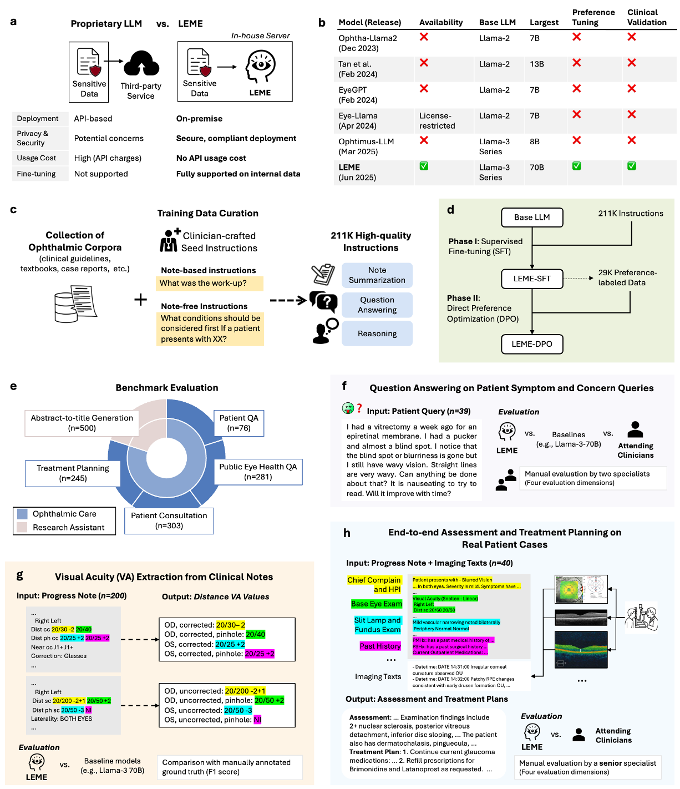
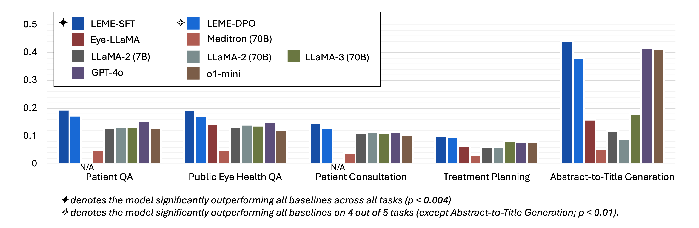

# LEME: Open Large Language Models for Ophthalmology

LEME is a family of open-weight language models for ophthalmology, designed
to support research in clinical reasoning, patient communication, and
clinical information extraction. The models can be deployed locally and
adapted to ophthalmology workflows.

Built on Meta-Llama-3-70B-Instruct, LEME combines supervised instruction tuning
with preference optimization to improve the truthfulness and informativeness
of responses. The study evaluates both models on five open-ended benchmarks
and three downstream tasks using real patient data and ophthalmologist review.

[Paper - npj Digital Medicine (2026)](https://doi.org/10.1038/s41746-026-03104-4)
· [Models](#models)
· [Datasets](#datasets)
· [Quick Start](#quick-start)
· [Citation](#citation)



*Study overview. Ophthalmology-specific data support instruction tuning and
preference optimization, followed by benchmark evaluation and clinical validation.*

## Models

Both checkpoints contain 70B parameters and are released as BF16 safetensors.
Model cards on Hugging Face include loading examples and license information.

| Model | Training | Training data |
| --- | --- | --- |
| [LEME-SFT-70B](https://huggingface.co/Yale-BIDS-Chen/LEME-SFT-70B) | Supervised fine-tuning | [211,149 instruction examples](https://huggingface.co/datasets/Yale-BIDS-Chen/LEME-Training-Data) |
| [LEME-DPO-70B](https://huggingface.co/Yale-BIDS-Chen/LEME-DPO-70B) | Direct preference optimization after SFT | [29,747 preference pairs](https://huggingface.co/datasets/Yale-BIDS-Chen/LEME-Training-Data) |

## Datasets

The data release connects the source corpus, the examples used to train LEME,
and the benchmarks used to evaluate it.

| Dataset | Content | Hugging Face configurations |
| --- | --- | --- |
| [LEME-Corpus](https://huggingface.co/datasets/Yale-BIDS-Chen/LEME-Corpus) | 22,099 ophthalmology guideline snippets, StatPearls snippets, and published case summaries | `guidelines`, `statpearls`, `cases` |
| [LEME-Training-Data](https://huggingface.co/datasets/Yale-BIDS-Chen/LEME-Training-Data) | 211,149 SFT examples and 29,747 DPO pairs | `sft`, `dpo` |
| [LEME-Benchmarks](https://huggingface.co/datasets/Yale-BIDS-Chen/LEME-Benchmarks) | 1,084 examples across three publicly released tasks | `public_eye_health_qa`, `patient_consultation`, `title_prediction` |

The corpus contains ophthalmology-specific subsets selected from broader
clinical guideline, StatPearls, and published case-report collections.
Clinician-designed prompts guided instruction generation and refinement;
preference pairs were constructed to favor truthful and informative responses.
The [training-data card](https://huggingface.co/datasets/Yale-BIDS-Chen/LEME-Training-Data)
describes the motivation and data construction, and each dataset card documents
its format, sources, and applicable terms.

## Quick Start

### Install

Clone the repository and install the inference dependencies in a Python 3.10
or 3.11 environment:

```bash
git clone https://github.com/Yale-BIDS-Chen-Lab/LEME.git
cd LEME
pip install -r requirements.txt
```

The example below loads the BF16 checkpoint. A 70B model requires substantial
memory: the weights alone occupy about 141 GB, with additional memory needed
for inference. `device_map="auto"` distributes the model across available devices.

### Run a model

```python
from transformers import AutoModelForCausalLM, AutoTokenizer

model_id = "Yale-BIDS-Chen/LEME-SFT-70B"
# For the preference-tuned model, use "Yale-BIDS-Chen/LEME-DPO-70B".

tokenizer = AutoTokenizer.from_pretrained(model_id)
model = AutoModelForCausalLM.from_pretrained(
    model_id,
    torch_dtype="auto",
    device_map="auto",
)

messages = [
    {"role": "user", "content": "Explain the difference between dry and wet AMD."}
]
inputs = tokenizer.apply_chat_template(
    messages,
    add_generation_prompt=True,
    return_dict=True,
    return_tensors="pt",
).to(model.device)

outputs = model.generate(**inputs, max_new_tokens=512, do_sample=False)
new_tokens = outputs[0][inputs["input_ids"].shape[-1]:]
print(tokenizer.decode(new_tokens, skip_special_tokens=True))
```

The same chat-template inference is available from the command line:

```bash
python -m leme.inference \
  --model leme-sft \
  --prompt "Explain the difference between dry and wet AMD."
```

Use `--model leme-dpo` to select LEME-DPO.

### Load the data

Released datasets can be loaded directly from Hugging Face:

```python
from datasets import load_dataset

corpus = load_dataset(
    "Yale-BIDS-Chen/LEME-Corpus", "guidelines", split="train"
)
sft = load_dataset(
    "Yale-BIDS-Chen/LEME-Training-Data", "sft", split="train"
)
dpo = load_dataset(
    "Yale-BIDS-Chen/LEME-Training-Data", "dpo", split="train"
)
benchmark = load_dataset(
    "Yale-BIDS-Chen/LEME-Benchmarks", "patient_consultation", split="test"
)
```

Select `statpearls` or `cases` for the other corpus subsets. The benchmark
configurations and their availability are listed below.

## Evaluation

The study covers five open-ended tasks spanning ophthalmic care and research
assistance. Publicly released tasks are grouped in
[LEME-Benchmarks](https://huggingface.co/datasets/Yale-BIDS-Chen/LEME-Benchmarks).

| Task | Examples | Public data |
| --- | ---: | --- |
| Patient QA · AAO | 76 | Not distributed due to licensing restrictions |
| Public Eye Health QA · NEI/NIH | 281 | `public_eye_health_qa` |
| Patient Consultation · iCliniq | 303 | `patient_consultation` |
| Treatment Planning · EyeRounds | 245 | Not distributed; redistribution permission was not granted |
| Abstract-to-Title Generation · PubMed | 500 | `title_prediction` |

Run a public benchmark with the study's task instructions and greedy decoding:

```bash
pip install -r requirements-evaluation.txt
python -m evaluation.run \
  --task patient_consultation \
  --model leme-sft \
  --tensor-parallel-size 2 \
  --output model_predictions/leme-sft/patient_consultation.jsonl
```

The runner saves predictions and ROUGE-L F1. See the
[evaluation guide](evaluation/README.md) for all tasks, local-file inputs,
and hardware options.



Beyond these benchmarks, clinical validation examines patient-query answering,
visual-acuity extraction from notes, and assessment and treatment-plan generation.
See the [paper](https://doi.org/10.1038/s41746-026-03104-4) for the full benchmark
results, downstream evaluations, and specialist assessments.

## Training and Data Construction

The released training data can be exported for LLaMA-Factory:

```bash
python -m leme.training.prepare_data --output-dir data/training
```

| Workflow | Documentation |
| --- | --- |
| Prepare SFT/DPO data and run the DPO training example | [Training guide](leme/training/README.md) |
| Select corpus text, generate and refine instructions, and construct preference pairs | [Data-construction guide](leme/data_generation/README.md) |
| Generate benchmark predictions and compute ROUGE-L | [Evaluation guide](evaluation/README.md) |

## Citation

If you use LEME models, data, or code, please cite:

Kim, H., Ai, X., Srinivasan, S. et al.
[LEME: open large language models for ophthalmology with advanced reasoning and clinical validation](https://doi.org/10.1038/s41746-026-03104-4).
*npj Digital Medicine* (2026).

```bibtex
@article{kim2026leme,
  title={LEME: open large language models for ophthalmology with advanced reasoning and clinical validation},
  author={Kim, Hyunjae and Ai, Xuguang and Srinivasan, Sahana and Gilson, Aidan and Singer, Maxwell B and Pushpanathan, Krithi and Xie, Qianqian and Park, Jungwoo and Applebaum, Serina and Yang, Gabriel Dawei and others},
  journal={npj Digital Medicine},
  year={2026},
  publisher={Nature Publishing Group UK, London},
  doi={10.1038/s41746-026-03104-4},
  url={https://doi.org/10.1038/s41746-026-03104-4}
}
```

Citation metadata is also available in [CITATION.cff](CITATION.cff).

## License

LEME code, models, data, and other related materials may be used for non-commercial research purposes. Any derivative works must be made publicly available through a public platform, such as GitHub or Hugging Face. For commercial-use inquiries, please contact us (`agreements@yale.edu` or `qingyu.chen@yale.edu`). Please see the [LICENSE file](LICENSE) for the full terms.

Model and dataset repositories include their applicable third-party terms.
See [NOTICE](NOTICE) for source-code attribution and retained upstream licenses.

## Contact

For general inquiries, please contact Hyunjae Kim at `hyunjae.kim@yale.edu`.


